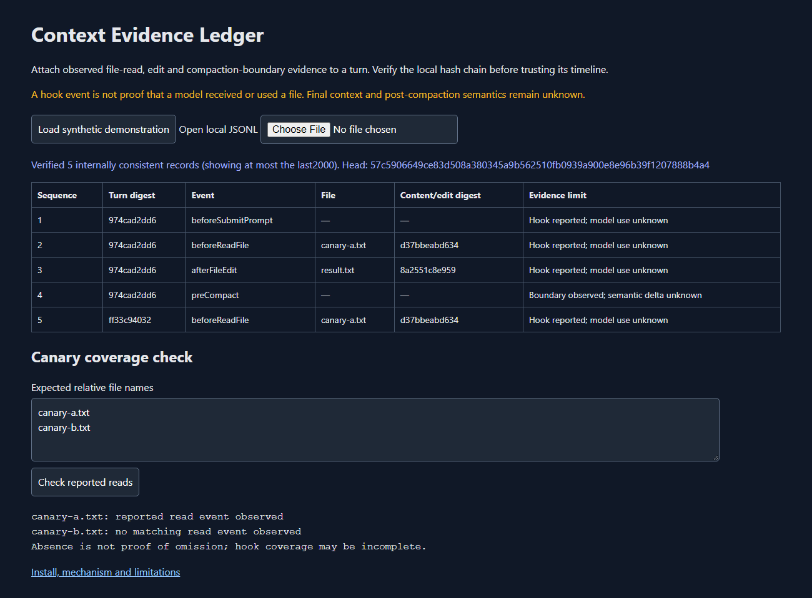

# Context Evidence Ledger for Cursor

When an AI coding edit surprises you, it helps to inspect the activity around it. This tool records selected events reported by Cursor and puts requests to read files, edits and chat-shortening events on one timeline.

You expected a coding run to consult two files, but its result seems to ignore one. Or the conversation was shortened partway through a long task. Instead of relying on memory, you can look for the events the recorder actually received.

**Example:** The example names canary-a.txt and canary-b.txt as files you expected to be consulted. It contains a reported read request for the first file but no matching event for the second. That gives you something concrete to investigate; it does not prove the second file was omitted from the model's input.

**What you install:** A project event recorder for Cursor, plus a separate viewer.

**Current scope:** The recorder cannot look inside the model, prove that a file was successfully read or used, or recover what remained after the conversation was shortened. Recorder and viewer tests passed; the setup still needs a test in a real Cursor session.

[Live guide](https://az9713.github.io/rea-cursor-context/) · [Download packages](https://github.com/az9713/rea-cursor-context/releases/tag/v0.1.1)

## Before and after

| Before | With this project |
| --- | --- |
| A context chart shows categories, while an edit lives elsewhere. | A per-turn timeline places reported reads, edits and compaction boundaries together. |
| It is easy to mistake an observed file read for proof of model use. | Every row states the evidence boundary; final model context and use remain unknown. |
| A transcript can be edited without an obvious consistency failure. | Verify a sequence/hash chain before display; retain its head independently for a stronger tamper check. |



Version0.1.1 clears the prior evidence immediately when a new load starts or is rejected. Older asynchronous file reads and digest checks cannot overwrite a newer selection.13actual browser checks include oversized-file and two stale-load regressions.

The recorder also preserves the20MB boundary before committing an append and handles a missing trailing JSONL separator.14core/process tests pass.

## Run the viewer

Extract the Windows release ZIP and run `ContextEvidenceLedger.exe`. It includes its runtime and needs no Node installation for viewing. Its writable profile remains beside the executable. Alternatively use the live browser app, or serve `docs/` with a local HTTP server. Open your local `events.jsonl` with the file picker. Files are processed locally, not uploaded.

## Add supported project hooks

The recorder requires Node22 or later. Put `src/hook.cjs` and `src/ledger.cjs` in your target project's `.cursor/context-ledger/`. Merge `fixtures/hooks.example.json` into that project's `.cursor/hooks.json`, preserving existing hooks and policy decisions. Hook commands run from the project root. The collector creates `.context-ledger/events.jsonl` there; add that directory to your project's `.gitignore` because filenames, timing and hashes can still be sensitive.

Do not install this as a permission/security gate: recorder failures exit nonzero and Cursor's documented default may allow the action. It records supported observations rather than deciding access. Existing policy hooks remain your responsibility. An abandoned `.context-ledger/write.lock` directory causes a visible recording failure; close all recorder processes and review that owned lock before removing it.

## Exact evidence contract

Supported events: beforeSubmitPrompt, beforeReadFile, afterFileEdit, preCompact and stop. Records contain hashed conversation/generation IDs, event order/time, relative file name, selected payload hashes and reported compaction metrics. The collector does not read source files independently. An outside-workspace path is marked without reading it.

`beforeReadFile` is a reported pre-read event, not proof that reading completed. Prompt attachments are counted, not reconstructed. Edit payloads are hashed; this does not prove which input caused an edit. Compaction boundaries/metrics are recorded; the semantic contents of the resulting summary are unobserved. Canary absence can reflect incomplete hook coverage. No server/model internals are recovered.

A local hash chain detects inconsistent edits, reordering and missing interior records. It cannot detect a fully rewritten chain or truncation of its tail without an independently retained expected head. Keep that limitation when sharing evidence.

## Build and verify

```sh
node --test tests/ledger.test.cjs
node scripts/demo.cjs
```

For a Windows desktop build, install pinned Electron45.2.1 locally with its cache redirected into the checkout, then run `python scripts/package-desktop.py`. The launcher exposes only packaged static assets on loopback; its renderer has no Node access or privileged IPC. Packaged `--self-test` checks renderer load and isolation; separate browser tests exercise the actual ledger behavior. The live Cursor host has not been exercised.

## Investigation and attribution

This is an original implementation using [documented Cursor hooks](https://cursor.com/docs/hooks). Native context breakdowns, checkpoints and SpecStory already cover adjacent needs. The added scope is a bounded evidence timeline and explicit unknowns; complete context admission or semantic compaction reconstruction is not claimed. No proprietary Cursor code/binary was modified or redistributed. This supported-interface route avoids assuming that a vendor-client RE investigation is permitted. See [Cursor's terms](https://cursor.com/terms-of-service).

MIT-licensed original code. Electron/Chromium licenses accompany the desktop runtime. This is an unaffiliated experimental project.
